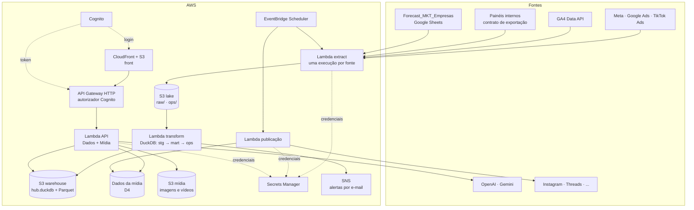

# Hub de Marketing Orbitus — Reimaginação do projeto

> Documento vivo. Define para onde o projeto vai; o código segue este documento,
> não o contrário. Decisões abertas estão marcadas como **[D#]** e só valem
> depois que o Nicolas escolher.
>
> Base: *Hub de Dados de Marketing Orbitus — Arquitetura e Plano Técnico*
> (Ricardo Monesi, 27/10/2026), *Hub de Marketing Orbitus — Telas* (5 telas) e o
> app atual de criação de mídia (KoinOps).

## 1. A ideia em uma frase

Um único app da Orbitus, todo na AWS, onde o marketing **cria e publica**
conteúdo e **mede** o que voltou — do anúncio e do post até a venda — por marca,
canal e campanha, com previsão do mês.

Hoje são duas coisas soltas: um painel de criação de posts (Supabase + GitHub
Pages + Lambda) e um plano de hub de dados (escrito para GCP). Elas viram uma só.

## 2. O que muda em relação ao que existe

| Antes | Depois |
|---|---|
| Supabase guarda os dados do app de mídia | Tudo na AWS; Supabase sai |
| Front no GitHub Pages, repositório público | Front em S3 + CloudFront, repositório privado |
| Backend numa Lambda criada à mão, deploy por script | Toda a infraestrutura descrita em código (um template), sobe numa conta nova com um comando |
| Login Cognito num pool criado à parte | Cognito criado pelo mesmo template, junto com o resto |
| Agendamento de publicação pelo cron do GitHub Actions | Agendamento pelo EventBridge Scheduler, dentro da AWS |
| Plano do hub em GCP (BigQuery, Looker, Cloud Run) | Mesmo plano em AWS (seção 5) |
| "Sites" no app de mídia e "marcas" no hub, cadastros separados | Um só cadastro de **marcas** usado pelas duas metades |
| Relatórios de tráfego digitados à mão | Números vêm das APIs, pelo hub |

A conta AWS atual (`980413094123`) vai ser desativada. **Nada do projeto novo
depende de recurso que existe nela hoje** (pool Cognito `us-east-2_fsv23otfO`,
Lambda `koinops-backend`, schedules). O template cria tudo do zero na conta
nova.

## 3. O app: duas metades, um login

```
Hub de Marketing Orbitus
├── Dados                      (as 5 telas do documento do Ricardo)
│   ├── Visão do grupo         sexta a quinta, hoje, 24h, mês; o que mudou
│   ├── Canal e campanha       Meta, Google Ads e TikTok numa régua só
│   ├── Por marca (funil)      anúncio → LP → cotação → lead → venda
│   ├── Previsão e pacing      projeção do mês × orçamento e meta; funil reverso
│   └── Saúde dos dados        qual fonte atrasou ou parou; alertas
├── Mídia                      (o que o app atual já faz, redesenhado)
│   ├── Conteúdo               kanban: rascunho → aprovação → agendado → publicado
│   ├── Criar                  post, imagem e vídeo com IA, a partir do contexto da marca
│   ├── Agenda                 fila de publicação por rede
│   └── Redes                  perfis oficiais por marca e o estado de cada token
└── Configuração
    ├── Marcas                 cadastro único (nome, sites, contas de anúncio, regras de lead, metas, tom de voz)
    ├── Fontes e credenciais   status de cada integração; segredos ficam no Secrets Manager
    └── Usuários               quem acessa o quê (Cognito)
```

### A ponte entre as duas metades

É o que justifica ser um app só, e não dois:

1. **Marca única.** A mesma marca que tem contas de anúncio e meta de leads no
   hub tem perfis, tom de voz e prompt de temas na mídia.
2. **Link com UTM no padrão.** Todo post publicado pela metade Mídia sai com UTM
   no padrão `ORB | Marca | Objetivo | Canal` (PMKT-307). O GA4 e os painéis
   internos já entendem esse padrão, então o tráfego e os leads do orgânico
   aparecem no hub sem trabalho extra.
3. **Resultado do conteúdo.** No hub, o orgânico deixa de ser "sem campanha":
   cada post publicado vira uma linha que dá para comparar com a mídia paga.

## 4. O que fica, o que muda e o que sai do app atual

| Hoje (aba) | Destino | Observação |
|---|---|---|
| Visão geral | **Sai** | Substituída pela Visão do grupo |
| Sites | **Vira Marcas** | Prompt de temas e referência do cofre migram para a marca |
| Redes | **Fica** (Mídia › Redes) | Foco em Instagram e Threads; as outras redes ficam no código, desligadas |
| Automações | **[D1]** | Hoje cria rascunho por cron; o agendamento foi desligado por pedido seu |
| Conteúdo (kanban) | **Fica** (Mídia › Conteúdo) | |
| Vídeos | **Fica** (Mídia › Criar) | Gemini Veo |
| Aprovações | **Fica**, dentro do kanban | A aprovação é uma etapa do conteúdo, não uma aba à parte |
| Relatórios | **Sai** | Os números vêm do hub, não são mais digitados |
| Suporte / FAQ | **[D2]** | |
| Configurações / Governança | **Vira Configuração** | |
| Cofre de senhas (KMS) | **[D3]** | |
| Geração de texto e imagem (OpenAI) | **Fica** | Chaves no Secrets Manager |
| Publicação nas APIs oficiais | **Fica** | Agendada pelo EventBridge, não mais pelo GitHub Actions |

## 5. Arquitetura na AWS



### Tradução do plano GCP do Ricardo

| Plano original (GCP) | Na AWS | Impacto |
|---|---|---|
| BigQuery (raw, stg, mart) | S3 (lake em JSONL) + DuckDB (warehouse reconstruído a cada carga, exportado em Parquet) | Volume de dezenas de milhares de linhas por dia cabe numa reconstrução completa; sem custo por consulta. Já está implementado e testado na branch |
| Cloud Run + Cloud Scheduler | Lambda + EventBridge Scheduler | Mesmas janelas: anúncios diário 06h reprocessando 7 dias, painéis de hora em hora, planilha semanal na quinta |
| Secret Manager | Secrets Manager | Só a Lambda de extração lê as credenciais das fontes |
| Export nativo do GA4 para BigQuery | GA4 Data API (agregado por dia × site × UTM) | Não temos evento cru, só agregados. Atende a `fct_web_daily`; não atende análise por sessão individual |
| Tabela externa do Sheets | Leitura da planilha pela API do Google, gravada no lake | Igual para o usuário |
| Looker Studio | Telas próprias, dentro do app | Sem licença; a identidade visual é nossa e as telas ficam no mesmo login da mídia |
| BigQuery ML ARIMA_PLUS (Fase 3) | **[D5]** | Amazon Forecast não aceita mais clientes novos |
| Alertas por e-mail ou Slack | SNS por e-mail; Slack depois, se quiser | |
| Grupo Google para acesso | Grupos do Cognito | |

O **contrato de exportação** dos painéis internos não muda:
`GET /api/marketing-export/{leads|conversoes}?updated_since=`, com token de
serviço e sem dado pessoal (só hash do contato).

### Infraestrutura como código

Um template SAM descreve todos os recursos acima. Subir o projeto numa conta
nova é: login na conta, `sam deploy`, cadastrar os segredos. Todos os nomes
levam o prefixo `hub-`, porque a conta pode ser compartilhada com outros
projetos.

Ambientes dev e prod ficam para depois. O template já recebe o nome do ambiente
como parâmetro, então separar mais tarde é subir uma segunda cópia com outro
nome, sem reescrever nada.

## 6. Decisões abertas

| # | Pergunta | Opções | Recomendação |
|---|---|---|---|
| D1 | Automações (rascunho automático por cron) continuam? | Sai · Fica como botão manual "gerar rascunho" · Fica com agendamento | Botão manual: você pediu criação manual, por custo e controle |
| D2 | Suporte / FAQ continua no app? | Sai · Fica | Sai: não é marketing de mídia nem dado; se precisar, volta como módulo separado |
| D3 | Cofre de senhas | Sai, e cada credencial vai direto para o Secrets Manager · Fica como tela para o time guardar senhas | Sai: o Secrets Manager já é o cofre, e segredo dentro de app de marketing é risco |
| D4 | Onde ficam os dados da mídia (marcas, conteúdos, fila, aprovações) | DynamoDB · Postgres (RDS ou Aurora Serverless) | DynamoDB: volume pequeno, sem servidor ligado, custo quase zero. Postgres só se você quiser SQL para esses dados |
| D5 | Modelo de previsão da Fase 3 | Modelo simples no próprio código (suavização exponencial no DuckDB) · SageMaker | Modelo simples: a Fase 3 pede faixa baixa e alta e uns 3 meses de histórico, não uma plataforma de ML |
| D6 | Login com Google (Workspace Orbitus) ou só e-mail e senha no Cognito | E-mail e senha · Google | E-mail e senha agora, como você pediu; Google entra depois sem mudar o resto |
| D7 | Região AWS da conta nova | us-east-2 (como hoje) · sa-east-1 (São Paulo) | sa-east-1: dado de lead brasileiro perto do Brasil (LGPD fica mais simples de explicar). Custo um pouco maior |
| D8 | Deploy automático pelo GitHub Actions | Manual (`sam deploy`) · Automático via OIDC | Pedir ao dono da conta nova a permissão de OIDC; até lá, manual |
| D9 | Redes sociais além de Instagram e Threads | Só essas duas · Mais alguma | Só essas duas por enquanto; o código das outras fica desligado |

## 7. Ordem de construção

Cada etapa termina com algo funcionando, mesmo antes da conta AWS nova existir.

1. **Repositório.** Repositório privado; este documento e a branch
   `feat/hub-rebuild` como base. Tudo roda local com dados de exemplo
   (`npm run pipeline` e `npm run dev`).
2. **App único, local.** Um front só com as metades Dados e Mídia; login Cognito
   simulado em modo local. Os dados da mídia já no modelo novo (D4), sem
   Supabase.
3. **Template SAM.** Toda a infraestrutura da seção 5 descrita e validada
   (`sam validate`), pronta para a conta nova.
4. **Conta nova no ar.** `sam deploy`, usuários no Cognito, app com dados de
   exemplo publicado no CloudFront.
5. **Dados reais, fonte por fonte.** Meta primeiro (PMKT-304), depois Google Ads
   e TikTok (PMKT-305), GA4, planilha e, por último, os painéis internos quando o
   Vinicius entregar os endpoints. Cada fonte só entra depois de bater com o
   gerenciador da plataforma (diferença de até 1%).
6. **Mídia real.** Tokens de Instagram e Threads, publicação agendada pelo
   EventBridge e UTM no padrão em todo post.
7. **Previsão** (Fase 3 do Ricardo): pacing já existe; funil reverso e modelo (D5).

## 8. Fora do escopo

Para o projeto não crescer para os lados:

- Coins, prêmios e resgates (já tinham saído do app).
- CRM ou atendimento ao cliente.
- Dado pessoal no warehouse (nome, telefone, CPF, placa): fica no backend de
  cada painel; o hub recebe só o hash.
- Ferramenta de BI genérica: as telas respondem às perguntas da seção 3, e só.
